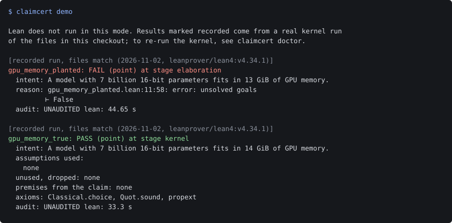

# claimcert

Check AI-written numeric claims with Lean's kernel; every pass lists the assumptions its proof used.



Same proof, one number changed. Seven billion 16-bit parameters is 14 billion bytes: it fits in 14 GiB and not in 13 GiB, and Lean will not finish a proof of the false one. The demo replays recorded Lean runs, so it needs only Python 3.11 or newer.

```bash
git clone https://github.com/jessejames1125/claimcert && cd claimcert
pip install .
claimcert demo
```

40 s on a clean Windows copy, clone and install included; the demo itself takes 1 s and runs no Lean.

## What you get

```text
[recorded result, not re-checked here; same files as that run (2026-11-02, leanprover/lean4:v4.34.1)]
gpu_memory_planted: FAIL (point) at stage elaboration
  intent: A model with 7 billion 16-bit parameters fits in 13 GiB of GPU memory.
  reason: gpu_memory_planted.lean:11:58: error: unsolved goals
          ⊢ False
  audit: UNAUDITED   lean: 53.67 s

[recorded result, not re-checked here; same files as that run (2026-11-02, leanprover/lean4:v4.34.1)]
gpu_memory_true: PASS (point) at stage kernel
  intent: A model with 7 billion 16-bit parameters fits in 14 GiB of GPU memory.
  assumptions used:
    none
  unused, dropped: none
  premises from the claim: none
  axioms: Classical.choice, Quot.sound, propext
  audit: UNAUDITED   lean: 100.06 s

[computed just now, no Lean needed]
rate_vs_size_planted: FAIL (point) at stage dimension
  intent: A 10 MB/s link stays under the 100 MB budget.
  reason: cannot compare T^-1 Bit^1 with Bit^1
  audit: UNAUDITED   lean: 0.0 s

[recorded result, not re-checked here; same files as that run (2026-11-02, leanprover/lean4:v4.34.1)]
inflight_requests_true: PASS (bound) at stage kernel
  intent: At a peak of 200 requests per second and 150 ms mean latency, at most 30 requests are in flight.
  assumptions used:
    LAW    littles_law  (source: Little's law: J. D. C. Little, A Proof for the Queuing Formula L = lambda W, Operations Research 9(3), 1961)
    NUMBER peak_rate  (source: illustrative value for this example; produced by: a load test you would run; made up here)
    NUMBER mean_latency  (source: illustrative value for this example; produced by: a load test you would run; made up here)
  unused, dropped: none
  premises from the claim (domains and conditions, not in the registry):
    domain    dom_lam: 0 < lam  (unused)
    domain    dom_W: 0 < W
  axioms: Classical.choice, Quot.sound, propext
  audit: UNAUDITED   lean: 109.08 s
```

FAIL names the stage that refused the claim: at `elaboration` Lean found no proof from the listed assumptions, and at `dimension` the units disagreed before Lean ran. PASS means the kernel accepted the proof. The `lean:` times are from the recorded run. The ledger is the point of the fourth claim: the arithmetic is proved, and the result still rests on one law and two numbers somebody measured. Each one is named, by kind, with its source.

| Kind | Meaning |
|---|---|
| LAW | a law or theorem from elsewhere |
| FIT | a fitted formula or survey value, with its range and date |
| TECH | a technology limit, with its date |
| NUMBER | a value computed outside Lean, with what produced it |

## Run the kernel yourself

Replay matches recorded results to your files and proves nothing new. Re-checking a proof needs Lean; `claimcert doctor` says what is missing.

```bash
claimcert doctor
claimcert setup    # Mathlib cache plus the Lean library
claimcert check examples/software/gpu_memory_planted.yaml
```

On a clean copy (16 GB Windows laptop, other programs open), `claimcert setup` took 64 minutes and about 8 GB, including one retry after the build ran short of memory. The first check took 208 s, the next 104 s.

## Write your own

```yaml
name: gpu_memory_true
type: point
intent: A model with 7 billion 16-bit parameters fits in 14 GiB of GPU memory.
constants: {params: "7e9", each: "2 B", capacity: "14 GiB"}
goals: ["params * each <= capacity"]
```

`claimcert new` generates and freezes the Lean statement. `claimcert prove --agent "<command>"` asks any command-line agent for the proof, or you write it. `claimcert check` decides. See [docs/claim-format.md](docs/claim-format.md).

## Proof

Each row reruns with the command shown; `--agent` takes the agent command given in [evals/README.md](evals/README.md), which also has the details and the full caveats.

| Set | Rerun | Result, 2026-11-02, one Windows laptop |
|---|---|---|
| 40 claims, 20 with a planted error, through Lean | `python evals/run_planted.py` | 0 of 20 planted passed, 0 of 20 true failed (one run, 42 min) |
| The same 40, Sonnet with no Lean, definitions given | `python evals/run_baseline.py --agent "<agent>"` | no mistakes in 3 runs |
| The same 40, Sonnet with no Lean, no definitions | `python evals/run_baseline.py --no-definitions --agent "<agent>"` | called 4 planted claims true in each of 3 runs |
| 12 translations, 6 deliberately wrong | `python evals/run_translation.py --agent "<agent>"` | Lean passed all 12; the blind audit caught 6 of 6 and flagged 1 of 6 faithful ones by mistake (one run) |
| 3 claims given to an agent to prove | `python evals/run_agent_proofs.py --agent "<agent>"` | both true claims proved; the false one refused with a counterexample (one run) |
| 25 examples in `examples/` | `claimcert check <claim.yaml>` | 12 PASS, 13 FAIL, each as intended |

**What the 40-claim number means.** Every planted error is in a goal value, so refusing it follows from Lean's soundness. It shows the plumbing works, not that the tool catches modelling errors, and a careful model ties it, as the baseline rows show. I designed the planted errors myself; an outside audit is owed.

**The first question to ask** is whether the formal statement says what the English says. Lean cannot tell you. The translation rows measure that gap on a small set: Lean passed every mistranslated claim, because each one is true mathematics. The blind audit caught all six, and flagged one of the six faithful claims by mistake.

## Why not something else

- **Ask the model to check its work.** Sonnet alone matched Lean on the planted set when the prompt spelled out the definitions, and missed all four geometry errors in every run when it did not. Its answer is a sentence to trust; a kernel run can be repeated by anyone, with its assumptions listed.
- **Unit tests or Hypothesis.** They check the inputs they try; a `bound` claim covers every real number in its range, as mathematics (see Limits).
- **Pint or astropy.units.** They catch unit mismatches in running code but prove no bound. Use them too.
- **Lean directly, with `#print axioms`.** That is the core of this tool. claimcert adds the claim format, a statement the proof cannot edit, a screen for untrusted proofs, the assumption ledger and the audit record.
- **lean-lsp-mcp.** It gives an agent Lean tooling and has no claim format or verdict. The two would work together.

I have not benchmarked against any of these.

## Limits

- **A PASS says nothing about translation.** A wrong formal statement passes if it is true. Run `claimcert audit-agent` or read it yourself. Verdicts say UNAUDITED until you do.
- **The claims here were written by hand.** Only the proofs in `evals/agent` came from a model. A model writing the YAML from a document is not measured.
- **Assumptions are not checked against the world.** A NUMBER that is wrong gives a PASS that is wrong. Contradictory premises prove anything; only the audit reads them.
- **Exact real arithmetic.** A claim says nothing about floating-point rounding, or about the code that uses the number.
- **Replay does not re-check proofs.** Anyone can edit a verdict file. `claimcert check` or the CI Lean job is the check.
- **It is heavy.** Setup takes about an hour; a check takes 1 to 4 minutes and peaks near 4.6 GB of memory. Linux is covered by the CI file only, which has not run yet.
- **Proofs are programs.** The screen is a denylist and Lean runs code during elaboration, so use a container for a stranger's proof. See [docs/trust.md](docs/trust.md).
- **Network.** `prove` and `audit-agent` send the Lean statement to the agent command you name. `setup` downloads from GitHub and the Mathlib cache. No telemetry.
- **Not built:** an MCP server. It would be a small wrapper over `check`.

## How it works

```
claim.yaml + registry.yaml
   |  units and dimensions checked exactly, in Python
   v
claim.lean: generated statement, frozen  +  proof from an agent or a person
   |  proof screen, then Lean compiles it; no keys, tokens or nonce in its environment
   v
claimcert-verify: a second program replays the result through the kernel
   |  and prints the only report line that is read, with a per-run nonce
   v
verdict: PASS or FAIL, stage, assumptions used, axioms, audit status, file hashes
```

About 1,600 lines of Python and 160 of Lean, on [LeanCert](https://github.com/alerad/leancert) and Mathlib (both Apache-2.0). It began as a gate on fusion engineering numbers; `examples/shielding` is what remains of that.

Contributing: [.github/CONTRIBUTING.md](.github/CONTRIBUTING.md). Security: [.github/SECURITY.md](.github/SECURITY.md). License: Apache-2.0. History: [HISTORY.md](HISTORY.md).
